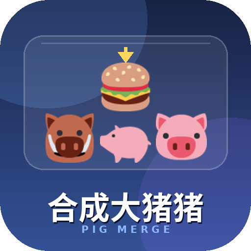

<p align="center"></p>

<h1 align="center">合成大猪猪</h1>

<p align="center">
  =4.16">
  
  
</p>

<p align="center">群里 @机器人 发一句「🐖游戏」，把一条一次性链接丢给群友；<br>
点开就是浏览器里的物理合成小游戏，分数自动记进档案，还能拼总榜和本群榜。</p>

---

## 这是什么

一个 AstrBot 插件，把「合成大西瓜」那套玩法做成**群聊入口 + 独立网页**：

- **玩游戏不用装东西** —— 链接点开就是网页，手机、平板、电脑浏览器都能玩，支持触屏、鼠标和键盘。
- **统计都在服务器里** —— 分数、局数、个人最高分存在插件自己的 SQLite 里，换浏览器也不丢（设了口令就能登回来）。
- **管理台直接嵌在面板里** —— 不用另开端口，看玩家、看对局、清分删档、改端口都在 AstrBot 面板里点。

游戏页是插件自己起的一个轻量 HTTP 服务（默认 `6100`，被占用时在 `6100~6110` 内自动顺延），
和 AstrBot 主面板互不影响。

## 功能

| | |
|---|---|
| 九级合成 | 🐽 → 🐷 → 🐖 → 🐗 → 🥓 → 🍖 → 🍔 → 🍲 → 👑，每级都是圆形贴图球，带物理碰撞 |
| 真物理 | 自研的圆体碰撞 + 重力 + 摩擦，罐子会满、会溢出，玩起来和原版手感接近 |
| 排行榜 | 总榜 + 本群榜（从群里点链接进来才有本群榜），可配显示人数 |
| 个人档案 | 昵称、最高分、局数、最近对局，注册后绑定当前会话 |
| 换设备 | 六位迁移码 `猪猪认领 8K3M5Q`，官方机器人 openid 变了也能把档案搬过去 |
| 一次性入口 | 群里发的链接只带一次性门票（默认 600 秒、点一次失效），长期凭证只存浏览器本地 |
| 深浅色 | 跟随系统 / 手动切换，选择记在本地 |
| 消息降级 | QQ 官方机器人走原生 Markdown，其他平台自动降级纯文本 |
| 面板管理台 | 服务状态、实际端口、玩家查询、清分删档、对局记录、运行设置 |

## 安装

```bash
cd /path/to/AstrBot/data/plugins
git clone https://github.com/REPLACE_ME/astrbot_plugin_pig_merge.git
```

然后在 AstrBot 面板 → 插件 → 重载（或重启 AstrBot）。

- 依赖：只要 `aiohttp`，AstrBot 自带，一般不用额外装。
- 端口：默认监听 `0.0.0.0:6100`，被占用会在 `6100~6110` 内顺延；
  记得在防火墙 / 云安全组放行实际端口（以管理台显示为准）。
- **对外地址一定要填**：服务器或容器里的「本机 IP」通常是 `172.x` / `10.x` 私网，
  留空时插件只能拿它拼链接，群友从外面点不开。到「猪猪管理台 → 运行设置 →
  对外地址」填 `http://你的公网IP:6100`，日志里那条 WARN 消失就对了。

## 聊天用法

> 触发规则是「**必须 @ 到机器人** + 关键词」，不做普通聊天关键词匹配，避免群里刷屏。
> 私聊里没有 @ 这回事，可以直接发（可在管理台关掉私聊入口）。

| 发送 | 结果 |
|---|---|
| `@机器人 🐖游戏` | 已注册：回专属链接 + 个人最高分 + 总榜前三；未注册：提示先登记名字 |
| `@机器人 🐷游戏` / `猪猪游戏` / `合成大猪猪` | 同上 |
| `猪猪注册 小猪快跑` | 注册猪农档案并绑定当前会话，重名会提示换一个 |
| `猪猪认领 8K3M5Q` | 换设备 / 换平台时，把旧档案迁到当前会话 |

> 这三个指令用 AstrBot 正规的 `@filter.command` 注册；装了 `astrbot_plugin_help`
> 的话，发「帮助」生成的帮助图里能看到它们。

## 配置项

在面板 → 插件 → 合成大猪猪 → 配置里改，或直接编辑
`data/config/astrbot_plugin_pig_merge_config.json`。

| 配置 | 类型 | 默认 | 说明 |
|---|---|---|---|
| `host` | string | `0.0.0.0` | 游戏页监听地址，反代/局域网都要连就别改 |
| `port` | int | `6100` | 游戏页端口，范围 6100~6110，占用自动顺延 |
| `public_base_url` | string | 空 | **对外地址**，如 `http://1.2.3.4:6100`；留空会用内网 IP，外网打不开 |
| `markdown_mode` | string | `auto` | `auto` 只有 QQ 官方用 Markdown；`always` / `never` 强制 |
| `board_size` | int | `10` | 聊天里报总榜时列几个人（3~20） |
| `session_link` | bool | `true` | 链接带会话标记，网页里能看本群榜 |
| `allow_private` | bool | `true` | 允许私聊要链接 |
| `submit_interval` | float | `1.5` | 同一玩家交分最小间隔（秒），防连点刷榜 |
| `keep_days` | int | `365` | 单局记录保留天数，个人最高分不受影响 |
| `default_theme` | string | `auto` | 网页默认主题：`auto` / `light` / `dark` |
| `link_ttl` | int | `600` | 入口链接有效期（秒），60~86400，点一次即作废 |

## 管理台

面板 → 插件 → 合成大猪猪 → **猪猪管理台**。

- 服务状态：是否在跑、实际端口、对外地址（以及是否回退到了内网地址）、数据库路径
- 概览：猪农数、今日对局、最高分
- 猪农档案：按名字搜、看绑定信息（平台 · 群聊/私聊 · 会话尾号）、清分、删档
- 对局记录：按玩家/会话筛选，一页 100 条
- 运行设置：端口、监听地址、对外地址、榜单人数、交分间隔、Markdown 模式、私聊开关

改端口或监听地址会立刻重启游戏页，不用重载整个插件。

## 数据与隐私

- 数据库：`data/plugin_data/astrbot_plugin_pig_merge/scores.db`（SQLite，WAL 模式）
- 档案里存：注册名、最高分、局数、绑定的 UMO / UID / 聊天昵称 / 群名、口令哈希
- 口令用加盐哈希保存，**不存明文**；入口 token 是随机串，等同登录凭证
- 单局记录默认留 365 天，个人最高分永久保留；每人最多留最近 80 局
- 插件不往外发任何请求，所有数据都在你自己的机器上

> 入口链接里的 token 就是登录凭证，别随手截图外传。发给别人的链接过期了让他重新
> @机器人 要一条就行。

## 常见问题

**群里发链接了，点开是「无法访问此网站」**
说明链接拼的是内网地址。去管理台把「对外地址」填成公网地址，并且确认安全组放行了端口。

**注册后换了浏览器就进不去？**
老版本注册的档案可能没设口令。现在用新链接打开会引导补设；实在不行让管理台删档重注册。

**「名字被占用了」**
同名档案已存在。要么登录进去，要么换个名字（`猪猪注册 别的名字`）。

**为什么 UMO 是一串看不懂的哈希？**
QQ 官方机器人给的是 openid，不是 QQ 号。这是平台特性，同一个人在同一机器人下是稳定的，
想换平台就用迁移码搬档案。

**罐子空空如也 / 画布一片白？**
部分内置浏览器内核不支持 `aspect-ratio`，v3.1.0 起已用 JS 兜底；还白就先换浏览器（Chrome / Safari / 微信内置均可）。

## 目录结构

```
astrbot_plugin_pig_merge/
├─ main.py                  # 后端：存储、触发、游戏页 HTTP 服务、管理 API
├─ _conf_schema.json        # 插件配置
├─ metadata.yaml            # 插件元数据
├─ logo.png                 # 插件图标
├─ web/                     # 游戏页静态资源（独立端口）
│  ├─ index.html
│  ├─ style.css
│  ├─ game.js               # 玩法、渲染、档案与登录
│  ├─ physics.js            # 圆体碰撞物理
│  └─ pigs/l1~l9.png        # 九级猪猪贴图
├─ views/admin/             # 面板内管理台
├─ .astrbot-plugin/i18n/    # 管理台中英文案
├─ CHANGELOG.md
└─ LICENSE
```

想换猪猪的图：直接替换 `web/pigs/l1~l9.png`，建议 240×240 透明底 PNG，圆形裁切会自动套上。

## 更新日志

见 [CHANGELOG.md](CHANGELOG.md)。

## 许可

[MIT](LICENSE) © 2026 idKang & DeepSeek娘

素材（九级猪猪贴图、logo）随仓库一起以 MIT 提供，可自由替换修改。
